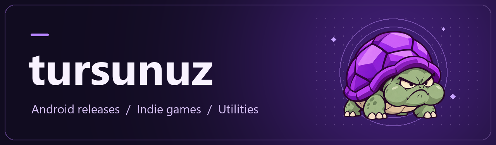

  

  I work on classic game compatibility, build small games, and develop practical utilities.
   
  <a href="https://github.com/tursunuz?tab=repositories"><strong>Browse repositories</strong></a>
  · tursunuz.com (coming soon)

## Projects

- **Classic game compatibility** — Projects that help older games run on current Android versions and modern devices.
- **Android releases** — Installable APKs for my Android projects.
- **Indie games** — Small games for the web and desktop.
- **Utilities** — Tools and automations that simplify everyday tasks.

## Downloads

Open a project's **Releases** page for available builds and release notes. Check its README for installation instructions, supported platforms, and usage details.
